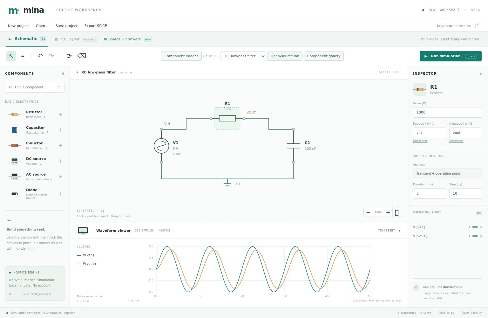

# Mina Circuit Workbench

A local electronics workbench with an interactive SVG schematic editor and **real ngspice simulation**. This is an initial working milestone, not a complete Proteus replacement.



## Run

1. Install Python 3.10+ and [ngspice](https://ngspice.sourceforge.io/download.html).
2. Ensure `ngspice` is on PATH, or set `NGSPICE_BIN` to the full executable path.
3. Run `python server.py` from this directory.
4. Open **http://127.0.0.1:8765**.

The analog workbench needs no Python packages or frontend build step. The board workspace additionally requires Node.js 18+ and `npm ci`. The UI runs in your browser and the server runs locally; this release is not a packaged native Windows executable. On Windows, set the engine location in PowerShell with `$env:NGSPICE_BIN = 'C:\path\to\ngspice.exe'` before starting the server. Windows packaging has not been tested.

## Working features

- Place, select, drag, rotate and delete resistors, capacitors, inductors, diodes and voltage sources.
- Connect component pins with the wire tool; edit values and named nodes in the inspector.
- Undo/redo, component search, zoom controls and keyboard shortcuts.
- Local autosave, `.mina` project downloads and import, plus SPICE netlist export.
- DC operating point and transient simulation through a native ngspice subprocess.
- Computed voltage traces, sample counts and operating-point measurements.
- Four executable examples: RC filter, resistor divider, RLC circuit and rectifier.
- Validation errors, timeout and missing-engine diagnostics; stale results clear on edits.

Wires carry explicit endpoint references. Named nodes also connect electrically, even without a drawn wire. Renaming a connected node renames that net. Diodes use a fixed generic silicon model, not manufacturer-specific parameters. The source value is peak amplitude for sine/pulse and DC voltage for DC.

## Not implemented

PCB editing/routing/3D/manufacturing outputs; MCU source-level debugging; physical hardware upload; AC sweep and advanced graph analyses; oscilloscope triggers/cursors; protocol analysers; flowcharts; IoT panels; arbitrary model imports; Proteus file compatibility; native desktop installer. See [full target inventory](docs/superpowers/specs/2026-10-23-electronics-workbench-design.md).

## Verify

```sh
python -m unittest discover -s tests -v
node --check web/app.js
```

Browser verification uses Playwright: install the version in `package.json`, run `npx playwright install chromium --only-shell`, then `npm run test:browser`. The browser test starts its own loopback server and writes an actual screenshot. Port 8765 must be free. It verifies calculated responses, editing, undo, persistence and viewport fit. Numerical tests check a 10 V equal-resistor divider and the RC charging time constant. The local server only accepts loopback Host headers and same-origin writes; it is not designed as a public hosted service.

## Reuse

ngspice performs the numerical calculations. No Proteus source code, bundled device models, artwork or libraries are included. Dependency details and scope are in [THIRD_PARTY.md](THIRD_PARTY.md). No license is assigned to this repository yet; do not assume unrestricted redistribution of the application until the owner chooses a license.


## Boards, sensors and installable libraries (v0.2)

Open **http://127.0.0.1:8765/boards.html** for the board workspace. To try it without installing an AVR compiler, choose a built-in sketch, click **Use example HEX**, then **Run firmware**. Editing/recompiling sketches and using additional libraries requires the AVR toolchain/core below. The source and compiled versions are included in `examples/firmware`.

- **Uno R3 / classic Nano:** ATmega328P firmware execution via AVR8js; GPIO, timers, ADC, UART output, EEPROM/SPI engine peripherals and an I²C temperature-register subset. The interactive sensor input uses A0; the backend accepts A0–A5. Peripheral APIs are not a claim of complete hardware conformance. Each run resets the emulated machine.
- **Arduino sketch compilation:** install `gcc-avr`, `binutils-avr`, `avr-libc` and `arduino-core-avr` on a compatible Linux distribution. Alternatively configure `AVR_GCC_BIN`, `AVR_GXX_BIN`, `AVR_OBJCOPY_BIN` and `ARDUINO_AVR_ROOT`. The latter points to the directory containing `cores/arduino` and `variants`. The compiler handles C++ sketch bodies with setup/loop; it does not provide the Arduino IDE's automatic function-prototype generation. Add forward declarations where C++ requires them.
- **Sensor models:** LM35 and TMP36 ideal voltage transfer; potentiometer and light-divider ideal 0–5 V inputs; LM75 temperature-register subset at I²C address 0x48 (0.5 °C resolution). Physical noise, calibration, loading, alarm and full configuration behavior are not implemented.
- **Library manager:** import local ZIP source libraries containing one `library.properties` and C/C++ headers/sources. Installed packages persist under `.state/libraries` or `MINA_LIBRARY_DIR`. An example package is `examples/libraries/DoubleADC.zip`. Requested headers and their detected dependencies are compiled into the firmware. Existing packages are not overwritten. Installer scripts and precompiled libraries are not supported. Driver installation does not create an electrical model.
- **Raspberry Pi Pico:** experimental single-core RP2040js UF2 application entry with an included original GPIO25 ARM example. The loader expects application vectors at flash + 0x100, bypasses ROM/boot2, captures UART0 and GPIO25, and rejects WFI/WFE sleep. It is not general Pico SDK, MicroPython, dual-core, USB serial or Raspberry Pi Linux support. Compiler support here is AVR-only; Pico requires a supported UF2 image or the included experiment.
- **Raspberry Pi 4/5, ESP32, STM32, PIC:** catalogue entries only; adapters pending and execution disabled.

Compiler input policy checks preprocessor dependencies against configured source/toolchain directories and rejects assembler file-read directives. Archive extraction rejects traversal, symlinks and oversized packages. These checks are **not an OS sandbox**: use trusted local toolchains, cores and source packages; never expose the development server as a public compile service. Total build time and source-file counts are bounded. The Windows compiler path and source policy have not been verified; tested platform is Linux.

Additional checks: `node --test tests/test_pico.cjs` and `npm run test:boards-browser` (after installing the Playwright browser). The latter tests sensor-driven firmware output, Wire/I²C traffic, installing and actually compiling a ZIP library, Pico execution and import races. See `docs/boards-delivery.md` for exact coverage.

## Measured Arduino instruments (v0.3)

The board workspace now includes 12 sensor/input models, GPIO logic traces, pulse width/frequency/duty measurements, VCD/CSV/execution exports, disconnected-sensor injection, and a fresh 14-case firmware/reference suite. Eight source/HEX examples cover ADC, I²C, blink, ultrasonic, digital input, Timer1 servo-style PWM, tone and analogWrite. See [model assumptions and validation](docs/instrument-validation.md). These are internal reference checks, not physical hardware validation.

## Illustrated components (v0.4)

All 33 component/output/instrument illustrations work offline. Use the searchable **Component gallery**, illustrated parts palette, or **Component images** circuit-view toggle. Board connectors are clickable for signal inspection; images preserve existing simulation models and support labels. See [artwork scope and verification](docs/component-art.md).

## Open-source integrations (v0.5)

The Open-source lab adds all 50 Wokwi elements from the pinned bundle, an optional Arduino CLI manager, a native PICSimLab DS1621 model and upstream sigrok SPI/I²C/UART decoders for captured GPIO. A Fritzing visual-part importer and Renode STM32F103 launch-profile exporter extend interoperability. Read [integration status and limits](docs/open-source-integration.md) before treating a visual part or external profile as a supported simulated device.

## MPU-6050 IMU (experimental register model)

In **Practical simulation** (`/lab.html`), load **MPU-6050 motion sensor (I²C)**. The included Arduino `Wire.h` sketch wakes the sensor, reads 14 accelerometer/temperature/gyroscope bytes and drives an LED. The editable three-axis acceleration, angular velocity and temperature inputs are forwarded to executable I²C registers, not illustrated outputs. Addresses 0x68 and 0x69, identity, sleep/reset and measurement ranges are included. See [behavioral scope, omissions and checks](docs/mpu6050-simulation.md). This does not add ESP32 firmware, mechanics, DMP or FIFO simulation.
